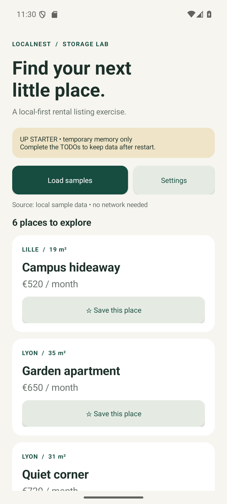

# LocalNest — Unfinished Project (UP)

**Android local storage: Room (SQLite) + SharedPreferences**

This is the student exercise, not the completed Demo. The Android app builds and
runs, but the storage layer intentionally uses temporary memory. Complete the
labelled TODOs to keep listings, favorites, language and filters after restart.
The app and tests use **Kotlin**, native Android Views and Gradle.
Room code is generated with KSP. Compose is optional for this storage topic.

## Open and run in Android Studio

1. Install a recent Android Studio compatible with Android Gradle Plugin 9.2.
2. Choose **Open** and select this folder, which contains `settings.gradle.kts`.
   On the author's machine it is `C:\Users\Administrator\IdeaProjects\kotlin`.
   Do not open just `app` or create a new project over these files.
3. Let Gradle sync. First sync needs internet to download dependencies.
4. In **Tools → SDK Manager**, install **Android SDK Platform 37** and
   **Android SDK Build-Tools 36.0.0** if requested. If your SDK Manager does not
   offer API 37, update Android Studio and the SDK command-line tools.
5. Under **Settings → Build, Execution, Deployment → Build Tools → Gradle**,
   use **Gradle Wrapper** and a **JDK 17 or newer** supported by Gradle 9.4.1.
   JDK 17 is the tested version.
6. In **Tools → Device Manager**, start/create an emulator with API 23 or newer,
   or connect a phone with USB debugging enabled.
7. Select the **app** run configuration and press the green **Run ▶** button.

The launcher name is **LocalNest UP**, application ID `edu.isep.localnest.up`.
No account, API key, server or internet permission is needed to run the app.

### Command-line alternative (Windows)

```powershell
.\gradlew.bat assembleDebug
.\gradlew.bat lintDebug
# Requires an emulator or connected phone:
.\gradlew.bat installDebug
.\gradlew.bat connectedDebugAndroidTest
```

If the SDK cannot be found, set its location in Android Studio or create an
untracked `local.properties` containing your own SDK path, for example:

```properties
sdk.dir=C\:/Users/Administrator/AppData/Local/Android/Sdk
```

Build output: `app/build/outputs/apk/debug/app-debug.apk`.
The Gradle Wrapper pins Gradle 9.4.1; AGP is 9.2.1 and Room is 2.8.5.

## Try the starter

1. Launch: an empty state explains how to load samples.
2. Tap **Load samples**: six rental listings appear, cheapest first.
3. Save a listing as a favorite; open **Settings** and enable favorites only.
4. Try the €800 budget filter and the English/French interface switch.
5. Force-stop and relaunch: the starter loses its listings and settings.
   **That is the exercise, not a working persistence implementation.** Rotation
   also recreates this starter's temporary storage.

Only interface labels switch language. Sample listing titles and city names are
content and remain unchanged.

## Your tasks

Read [EXERCISES.md](EXERCISES.md). Start with these files:

| File | Purpose |
| --- | --- |
| `data/Listing.kt` | Room entity / SQLite table |
| `data/ListingDao.kt` | Supplied SQL queries and insert/update operations |
| `data/AppDatabase.kt` | Room singleton, database `localnest.db` |
| `data/ListingRepository.kt` | **UP-1, UP-2, UP-3:** replace memory with Room |
| `data/UserPreferences.kt` | **UP-4:** implement preference restore/save |
| `data/SampleData.kt` | Six bundled listings, a simulated server response |
| `MainActivity.kt` | Supplied UI and background executor |

All Kotlin files are under `app/src/main/java/edu/isep/localnest/`.
Storage work already runs off the main thread. Do not add `allowMainThreadQueries()`.

## Teaching scope

- Room is an abstraction over **SQLite**, so Room still demonstrates local SQLite storage.
- Store structured, queryable listing rows in Room; small settings in SharedPreferences.
- The sample import simulates caching a server response. There is no real networking.
- No automatic reset, schema migration, login or cloud synchronization is included.
- Do not clear app storage when testing persistence: clearing storage/uninstalling
  intentionally removes the database and preferences.
- The completed Demo should be maintained separately; this UP repository should
  remain a usable exercise without a committed solution.

See [docs/RUN_ZH.md](docs/RUN_ZH.md) for Chinese setup and demonstration instructions,
and [docs/VALIDATION.md](docs/VALIDATION.md) for verification results.
For a plain-language explanation of the course deliverables, read
[docs/ASSIGNMENT_ZH.md](docs/ASSIGNMENT_ZH.md).



## Course submission

The current repository name is `kotlin`. The assignment screenshot requires a
name following `II.3510_2627_Skills_Topic`; rename the repository to match the
teacher's exact prefix before final submission. `Wangyinji/kotlin` is **public**
as verified at delivery.
Put your actual member names in your report/slides; none are invented here.
Upload your presentation to this public UP repository when ready. The PDF report,
complete-project ZIP and slides also need their Moodle submissions.

## References

- [Room overview](https://developer.android.com/training/data-storage/room)
- [Room dependencies](https://developer.android.com/jetpack/androidx/releases/room)
- [SharedPreferences](https://developer.android.com/training/data-storage/shared-preferences)
- [AGP 9.2 compatibility](https://developer.android.com/build/releases/agp-9-2-0-release-notes)

Android recommends DataStore for new settings features; this exercise deliberately
uses SharedPreferences because that is the assigned topic.
